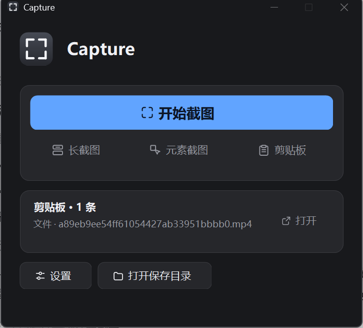
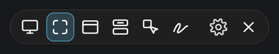
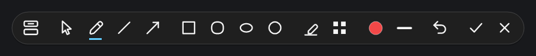
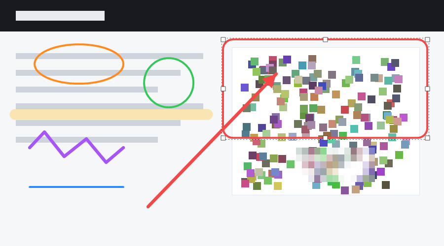
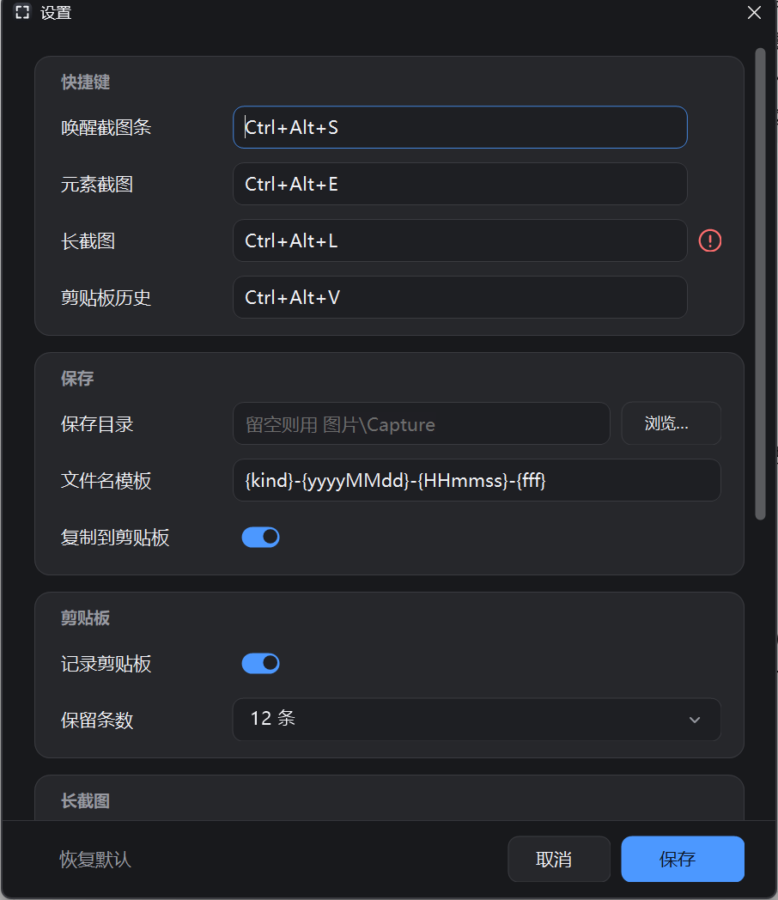

# Capture

Windows 10/11 上的轻量截图工具：区域、窗口、元素、长截图、任意形状，自带标注与剪贴板历史。WinForms 自绘界面，深浅色自适应，不联网。



## 下载

从本仓库 [Releases](https://github.com/Badannu/Capture/releases) 页下载（**x64 的 Windows 10 1809+ 或 Windows 11**），文件名里的版本号以 Releases 上的为准：

| 包 | 大小 | 适合谁 |
| --- | --- | --- |
| `Capture-<版本>-setup-win-x64.exe` | 46.50 MB | 大多数人。双击安装，默认只装给当前用户、不弹 UAC，卸载在「应用和功能」里。安装后约 249 个文件 / 150.1 MB。 |
| `Capture-<版本>-portable-win-x64.zip` | 57.97 MB | 不想安装、或要放进 U 盘带着走。解压即用，设置和历史写在 exe 旁边，删文件夹等于彻底卸载。解压后只有一个 66.5 MB 的 exe。 |

- **不需要任何运行时**：两个包都自带 .NET 8 桌面运行时，此外不需要 VC++ 运行库、WebView2 或额外字体。
- **未做代码签名**，第一次运行 Windows SmartScreen 会拦一次：「更多信息 → 仍要运行」即可。
- 卸载**不会**删你的设置和剪贴板历史：卸载器只清掉开机自启项，并告诉你数据还留在哪个目录。
- 从 1.4.x 升级：设置与剪贴板历史自动迁移，旧的开机自启项会被自动替换，无需手工处理。
- 完整依赖清单、写入位置、出包与验收步骤见 [PACKAGING.md](PACKAGING.md)。

## 功能

### 六种截图模式

按热键（默认 `Ctrl+Alt+S`）唤起后整屏变暗，顶部正中是功能胶囊条，当前模式以蓝色底板高亮：



1. **全屏** — 截取鼠标所在的那一块显示器（含任务栏）。
2. **矩形** — 拖一个矩形，洞外变暗、洞内保持原亮度。
3. **窗口** — 悬停高亮顶层窗口，单击选中。
4. **任意形状** — 按住画出闭合路径，路径外在保存的 PNG 里是透明的。
5. **长截图** — 先框出要拼接的区域，松手后自动滚动拼接成一张长图。
6. **元素截图** — 悬停高亮 UI Automation 控件，单击截取，滚轮切换父子层级。

### 标注

选区确定后，选区下方出现同风格的标注条：



从左到右：长截图 ｜ 选择、画笔、直线、箭头 ｜ 矩形、圆角矩形、椭圆、圆 ｜ 高亮、马赛克 ｜ 颜色、粗细、撤销、**✓ 保存**、**✗ 放弃**。

- **颜色**是八色预设（红橙黄绿蓝紫白黑），**粗细**四档，不弹色盘，选完即用；小组件不会自己消失，可以连着换。
- **选择**工具可移动、缩放已画的标注（八个手柄），选中后按撤销即删除。
- 长截图按钮用当前选区直接进入滚动拼接。



### 设置



按「快捷键 / 保存 / 剪贴板 / 长截图 / 常规」分块：四个全局热键、保存目录、文件名模板、是否复制到剪贴板、剪贴板记录开关与保留条数、长截图速度与采样间隔、外观（深浅色）、开机自启、关闭窗口后是否常驻托盘。全部保存在 `%AppData%\Capture\settings.json`。

热键被别的软件占用、或两行写成同一个组合键时，对应行右侧出现**红色感叹号**，点开可以看到是哪个组合键、大概率被谁占用；主窗口底部也会有一行提示。

### 剪贴板历史

按 `Ctrl+Alt+V` 打开面板：文本、图片、文件三类记录，双击文本重新复制、双击图片用「照片」打开；右键支持复制、另存为、在文件夹中显示、置顶、删除。同样的内容再复制一次不会重复记录，而是移到最前。记录以明文 PNG + `index.json` 存在 `%AppData%\Capture\clipboard\`。

## 全局热键

| 热键 | 作用 |
| --- | --- |
| `Ctrl+Alt+S` | 唤起截图条（矩形模式） |
| `Ctrl+Alt+E` | 唤起截图条，预先选中「元素截图」 |
| `Ctrl+Alt+L` | 唤起截图条，预先选中「长截图」 |
| `Ctrl+Alt+V` | 打开剪贴板历史 |
| `Esc` | 取消当前截图；长截图里则停止并保存已拼好的部分 |

热键都可以在设置里改。

## 使用说明

**基本截图**：按 `Ctrl+Alt+S` → 矩形模式按住左键拖动（窗口模式悬停单击、任意形状按住画路径）→ 松手后用标注条编辑 → 点 ✓ 保存到设置目录，默认同时复制到剪贴板；✗ 或 `Esc` 丢弃。

**元素截图**：按 `Ctrl+Alt+E` → 鼠标移到目标控件上（会以原亮度洞高亮并标注类型和名称）→ 滚轮选父级/子级 → 左键截取。没有控件树的区域（游戏、自绘画布）会提示改用矩形。

**长截图**：按 `Ctrl+Alt+L` → 框出可滚动的内容（不要框住固定的标题栏、状态栏）→ 松手后程序自动滚动拼接，屏幕上的亮洞始终是你松开时的矩形 → 滚动滚轮可随时切换为手动 → 内容到底或按 `Esc` 时保存已拼好的部分。高度上限 20000 像素、帧数上限 150。

**托盘**：程序启动后停在托盘，左键图标打开主窗口，右键菜单有截图、长截图、元素截图、剪贴板、设置、退出。主窗口的关闭按钮默认只是回到托盘，在设置里关掉「常驻托盘」后关窗口即退出。

## 资源占用

| 状态 | 内存（任务管理器·工作集） |
| --- | --- |
| 后台常驻托盘 | 约 3 MB |
| 截图进行中 | 约 70 MB |

## 输出

默认保存到 `%USERPROFILE%\Pictures\Capture\`，文件名如 `element-20261027-153045-123.png`，可在设置里改目录和模板。

## 已知限制

- 没有辅助功能树的界面（多数游戏、自绘画布）元素模式高亮不到控件，只能拖矩形。
- 截到的是屏幕可见像素，被别的窗口挡住的部分会带上前面的内容。
- 长截图假定选区内容整体向上平移；跑马灯、视频进度条这类持续动画的区域会造成重复，别框进选区。只做向下滚动。
- 全屏只截鼠标所在的那台显示器；多显示器需要各自截一次。
- 任意形状保存的 PNG 路径外是透明的；从标注条进入长截图时用的是外接矩形。
- 剪贴板历史只认文本、图片、文件三项；富文本按纯文本记录。上限 30 条，明文保存不加密。
- 多显示器混用不同 DPI 时，极少数跨屏窗口的框可能偏几个像素。

## 问题反馈

- Telegram：`Guth_Lee`
- 邮箱：`guthirelee@gmail.com`

设置页滚到底部也有这两行，点一下即复制。反馈时请带上：`Capture.exe --version` 的输出版本、Windows 版本与显示缩放、复现步骤（截图类问题附原图，长截图问题说明选区里有没有固定标题栏/状态栏）。

## 许可

本仓库代码以 [MIT](LICENSE) 发布。元素命中使用 [FlaUI](https://github.com/FlaUI/FlaUI) 5.0.0（MIT，经 NuGet 引用）。长图行对齐与元素选择参考了公开的交互思路（如 Snow Shot），未复制任何第三方源码，详见 [ARCHITECTURE.md](ARCHITECTURE.md)。

## 从源码构建

- 环境：Windows + [.NET 8 SDK](https://dotnet.microsoft.com/download/dotnet/8.0)（Linux 可交叉编译，但 WinForms 窗口必须 Windows 运行）。
- 声明了 Per-Monitor V2 DPI：高分屏上 UIA 边界、鼠标坐标与 `CopyFromScreen` 使用同一套物理像素。
- 版本号唯一来源是 `Directory.Build.props` 的 `<Version>`，exe 属性、设置页页脚、`--version` 三处同步。

```powershell
dotnet build CaptureDemo.sln -c Release      # 构建
dotnet test CaptureDemo.sln -c Release       # 单测（拼接/停止条件在 Core 层，可跨平台跑）
dotnet run --project src/CaptureDemo/CaptureDemo.csproj -- --snip   # 直接进入截图模式
```

出发布包（需要 [Inno Setup 6](https://jrsoftware.org/isinfo.php) 编译安装器，缺了会跳过并只出 zip）：

```powershell
powershell -ExecutionPolicy Bypass -File .\pack.ps1
#   dist\Capture-<版本>-setup-win-x64.exe     Inno Setup 离线安装器
#   dist\Capture-<版本>-portable-win-x64.zip  单 exe 便携包
#   -SetupOnly / -PortableOnly / -NoSetup 只出其中一种
#   -OnlineOnly 额外产出框架依赖版（需目标机已装 .NET 8 Desktop Runtime，默认不出）
```

界面截图（开发用，Release 包不带）：Debug 构建下运行 `Capture.exe --ui-demo <输出目录>`，会批量渲染主窗口、设置页、胶囊条、标注栏等全部界面（深浅两套）。
